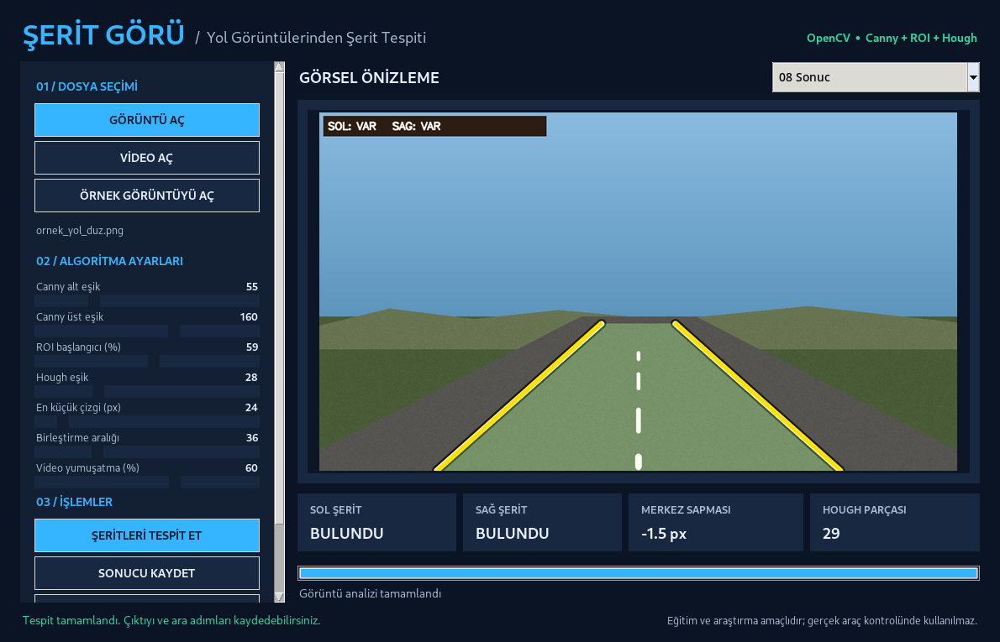

# ŞERİT GÖRÜ AI V2 — Yol Görüntülerinden Şerit Çizgisi Tespiti


**Yeni sürüm:** Eğitilmiş bir **PyTorch U-Net** örnek modeli (`modeller/serit_unet_demo.pt`), eğrisel renk tabanlı şerit izleme, dört algoritma modu ve yeni eğitim/etiketleme/değerlendirme araçları içerir. Önceki Canny–Hough modu karşılaştırma için korunmuştur.

**En hızlı AI kurulum:** Windows için `baslat_ai_windows.bat`, diğer platformlarda `python -m pip install -r requirements-ai.txt` ve `python app.py`. `baslat_windows.bat` ise PyTorch olmadan çalışır; otomatik mod gerekirse eğrisel algılamayı kullanır.

**Virajlı yol denemesi:** Gerçek kullanıcı görüntüsü üzerinde de test yapıldı; hak/mahremiyet gerekçesiyle ham görsel ve bu görüntüden türetilen çıktılar açık kaynak depoya eklenmedi. Yerel paket içinde mevcuttur.

**Eğitim:** 120 sentetik görüntü üretildi, 18'i sentetik doğrulamaya ayrıldı; ayrıca 1 gerçek ekran görüntüsünün yol bölümü elle/kabaca etiketlenerek eğitim setine eklendi (bu özel veri GitHub'da paylaşılmadı). En iyi sentetik doğrulama IoU'su 8. epoch sonunda **0,6524**. **Gerçek yol verisiyle bağımsız test yapılmadı; bu gerçek yol başarısı değildir.** Ekran görüntüsüyle yapılan test eğitim verisi içerdiği için yalnızca *gösterim*dir.

**Gerçek yol görüntülerini etiketlemek ve modeli geliştirmek için** [AI eğitim ve test rehberine](docs/AI_EGITIM_REHBERI.md) bakın.

## AI V2 yöntem ve komutları

| Yöntem | Açıklama | Gereksinim |
|---|---|---|
| Otomatik | U-Net, kalite kontrolü ve eğrisel/klasik yedekleme | OpenCV; PyTorch isteğe bağlı |
| Yapay zekâ | İki sınıflı pikselleri U-Net ile segmentler | PyTorch + `modeller/*.pt` |
| Eğrisel renk takibi | Beyaz/sarı işaretleri izler, polinomla eğri çıkarır | OpenCV |
| Klasik Canny + Hough | Önceki projenin temel yöntemi | OpenCV |

```bash
python cli.py --input ornekler/ornek_yol_duz.png --output sonuc.png --mode auto --steps
python cli.py --input ornekler/ornek_yol_video.mp4 --output sonuc.mp4 --mode auto
python etiketle.py --image yol.jpg --name yol_002
python egit.py --synthetic 120 --epochs 10 --batch 4
python degerlendir.py --folder data/test
python -m pytest -q
```

> Fotoğraf/video sonuçlarındaki `sol/sağ bulundu` ifadesi, yalnızca algoritmanın iki aday çizgi raporladığı anlamına gelir. Bu, gerçek doğruluk olasılığı değildir. Sürüşte kullanmayın.

---

## Önceki projenin kurulum, API ve detaylı kullanım rehberi




**Üniversite düzeyinde görüntü işleme projesi.** Python, OpenCV, NumPy ve Tkinter kullanılarak hazırlanmıştır. Ön kamera açısıyla çekilmiş yol fotoğraflarında ve videolarında sağ/sol şerit çizgilerinin yaklaşık doğrusal sınırlarını bulur, algılanan yol alanını renklendirir ve işlem aşamalarını gösterir. **Gerçek araç kontrolü için tasarlanmamıştır.**

> **Önemli:** Birlikte gelen yol örnekleri bilgisayarda üretilmiş **sentetik** görsellerdir. Testlerde iyi sonuç elde edilmesi gerçek yolda aynı performansı garanti etmez. Gerçek görüntü verisiyle ayrı değerlendirme yapılmalıdır.

## Özellikler

- Koyu temalı **Türkçe masaüstü arayüz** (Windows / Linux / macOS'da Python/Tk desteğiyle)
- Fotoğraf veya video seçimi, görsel önizleme ve sonucu kaydetme
- İşleme zinciri: **Grileştirme → Gaussian Blur → Canny → ROI → HoughLinesP → Şerit tahmini**
- Sol ve sağ şerit sınırlarını çizme, ikisi de mevcutsa arayı renklendirme
- Canny, ROI, Hough ve video yumuşatma parametrelerini arayüzde değiştirme
- Fotoğraflarda **8 ayrı görsel aşamayı PNG** olarak kaydetme
- Videoları akış hâlinde işleme, **durdurma**, tamamlanma ilerlemesini izleme
- Videoda otomatik **MP4 + CSV (kareler) + JSON (özet/parametreler)** çıktıları
- Şerit merkezinin **görüntü merkezine göre piksel sapması** (metre cinsinden değildir)
- Komut satırından çalıştırma, örnek test verisi ve otomatik testler

## 1 — Windows'ta en kolay kurulum

1. [Python 3.10 veya daha yenisini](https://www.python.org/downloads/) kurun; kurulumda **Add Python to PATH** seçeneğini işaretleyin.
2. Projenin ZIP arşivini çıkartın.
3. `baslat_windows.bat` dosyasına çift tıklayın. İlk çalıştırmada gerekli kütüphaneler kurulacak, sonra grafik arayüz açılacaktır. İnternet bağlantısı ilk kurulumda gereklidir.
4. **ÖRNEK GÖRÜNTÜYÜ AÇ → ŞERİTLERİ TESPİT ET** ile başlayın.
5. **SONUCU KAYDET** ve **ARA ADIMLARI KAYDET** ile çıktı alın.

**Windows'ta elle kurulum (VS Code terminali / PowerShell):**

```powershell
cd serit_tespiti_projesi
py -3 -m venv .venv
.\.venv\Scripts\python.exe -m pip install -r requirements.txt
.\.venv\Scripts\python.exe app.py
```

**Linux / macOS:**

```bash
python3 -m venv .venv
source .venv/bin/activate
python -m pip install -r requirements.txt
python app.py
```

> Linux'ta `tkinter` eksikse sistem paket yöneticisinden Python Tk desteğini kurun (ör. Ubuntu/Debian: `sudo apt install python3-tk`). Grafik arayüzü olmayan sunucuda `cli.py` kullanılabilir.

## 2 — Uygulamanın kullanımı

**Fotoğraf:** GÖRÜNTÜ AÇ → örn. `ornekler/ornek_yol_duz.png` → ŞERİTLERİ TESPİT ET → açılır menüden 01–08 işlem aşamalarını incele → kaydet.

**Video:** VİDEO AÇ → örn. `ornekler/ornek_yol_video.mp4` → ŞERİTLERİ TESPİT ET → çıktı MP4 dosyasının konumunu seç. İşlem sürerken kare görüntüsü ve sayaç güncellenir. Sonunda seçilen klasörde MP4, `_istatistik.csv`, `_ozet.json` bulunur. Video işleminde seçilen aşama yerine sonuç önizlemesi gösterilir. Videonun **sesi korunmaz**.

**Parametreler:**

| Ayar | Açıklama | Varsayılan |
|---|---|---|
| Canny alt / üst eşik | Kenar duyarlılığı | 55 / 160 |
| ROI başlangıcı | İncelenecek bölgenin üst sınırı, görüntü yüksekliğinin yüzdesi | %59 |
| Hough eşik | Minimum oy desteği | 28 |
| En küçük çizgi | Doğru parçasının minimum uzunluğu (piksel) | 24 |
| Birleştirme aralığı | Hough'daki maksimum boşluk (piksel) | 36 |
| Video yumuşatma | Önceki karenin tespitine verilen ağırlık | %60 |

**Not:** Algoritma, alt-üst eşikler için alt değerin üst değerden küçük olmasını ister. Parametreleri değiştirince tekrar **ŞERİTLERİ TESPİT ET** düğmesine basın. Farklı kamera açıları için ROI yatay köşelerini değiştirmek isterseniz `lanevision/core.py` içindeki `LaneSettings` yapılandırmasını güncelleyebilirsiniz.

## 3 — Komut satırından çalıştırma

```bash
# Tek fotoğraf, ara adımlar da kaydedilir
python cli.py --input ornekler/ornek_yol_duz.png --output sonuc.png --steps

# Video ve otomatik CSV/JSON istatistikleri
python cli.py --input ornekler/ornek_yol_video.mp4 --output sonuc.mp4

# Parametreleri değiştirerek bir fotoğrafı işle
python cli.py --input ornekler/ornek_yol_duz.png --output sonuc2.png --canny-low 40 --canny-high 130 --roi-top 0.60
```

## 4 — Proje dizini

```text
serit_tespiti_projesi/
├── app.py                       # Masaüstü uygulama başlangıç noktası
├── baslat_windows.bat           # Windows tek tıkla kur/başlat
├── cli.py                       # Arayüzsüz (komut satırı) çalıştırma
├── requirements.txt             # Çalıştırma kütüphaneleri
├── requirements-dev.txt         # Test geliştirme kütüphaneleri
├── lanevision/
│   ├── core.py                  # Canny, ROI, Hough, çizgilerin belirlenmesi
│   ├── processing.py            # Görüntü/video giriş çıkış, raporlar
│   ├── gui.py                   # Türkçe Tkinter arayüz
│   └── sample_data.py           # Örnek veri üretici
├── ornekler/                    # Sentetik iki PNG + kısa MP4
├── ornek_sonuclar/              # Gerçek çalıştırma çıktıları ve ekran görüntüsü
├── docs/
│   ├── PROJE_RAPORU_TASLAGI.md
│   └── DENEY_PLANI.md
└── tests/                       # 8 otomatik test
```

## 5 — Çalışan testler ve sonuçların yorumu

Testleri çalıştırın:

```bash
python -m pip install -r requirements-dev.txt
python -m pytest -q
```

Örnek betiği yeniden üretmek isterseniz: `python -m lanevision.sample_data`.

Bu paketin sentetik örneklerindeki son doğrulamada:

- Düz görsel: **her iki şerit bulundu**; merkez sapması yaklaşık **-1,5 px**.
- Düşük ışık örneği: **her iki şerit bulundu**.
- 36 karelik sentetik video: **36 karede iki şerit de çizildi**.
- 8 otomatik test başarılı.

**Bunlar gerçek veri kümesi üzerinde doğruluk yüzdeleri değildir.** Videodaki `iki_serit_tespit_orani_yuzde`, yalnızca iki tarafı birlikte işaretleyen karelerin oranıdır. Şeritlerin gerçekten doğru işaretlenip işaretlenmediğini ölçmez.

## 6 — Sınırlamalar

- Temel algoritma doğrusal şeritlere uygundur; keskin viraj, kavşak, dağılmış yol işaretleri ve çoklu şeritlerde hatalı olabilir.
- Yağmur, kar, gölgeler, far parlaması, gece, silik çizgiler ve kamera açısı değişiminde yanlış pozitif veya eksik tespit oluşabilir.
- Her iki şerit bulunmazsa yeşil alan doldurulmaz ve sapma hesaplanmaz.
- Piksel merkez sapması **gerçek şerit ihlali veya fiziksel mesafe ölçümü değildir**; gerçek bir uyarı sistemi için kamera kalibrasyonu gerekir.
- MP4 yazma, OpenCV'nin `mp4v` codec desteğine bağlıdır; ses aktarılmaz. Video giriş yolu Türkçe karakterliyse bazı Windows/OpenCV derlemelerinde açılmayabilir; basit Latin harfli dosya yolu deneyin.
- Deneysel prototip **ADAS, sürücüsüz sürüş veya güvenlik-kritik** uygulamalar için uygun değildir.

## 7 — Üniversite tesliminde eklenmesi gereken gerçek deney

En az 30–50 farklı gerçek yol fotoğrafı toplayıp (veya lisans/izin koşullarına uygun açık veri kullanıp) yol ve şerit çizgilerini insan tarafından etiketleyin. Farklı ortam koşullarını ayrı ayrı raporlayın. **Başarıyı** gerçek etiketlerle karşılaştırarak hesaplayın; sadece çizginin var olması yeterli değildir. Deney protokolü için `docs/DENEY_PLANI.md`, düzenlenebilir rapor metni için `docs/PROJE_RAPORU_TASLAGI.md` dosyalarına bakın.

## Kaynaklar

- OpenCV [Canny Edge Detection](https://docs.opencv.org/4.x/da/d22/tutorial_py_canny.html)
- OpenCV [Hough Line Transform](https://docs.opencv.org/4.x/d9/db0/tutorial_hough_lines.html)
- OpenCV [Video I/O](https://docs.opencv.org/4.x/dd/d43/tutorial_py_video_display.html)
- [TuSimple Lane Detection Benchmark](https://github.com/TuSimple/tusimple-benchmark) (isteğe bağlı gerçek veri kümesi; lisansı ve erişim koşullarını kontrol edin)

**Lisans notu:** Proje için verilen örnek PNG ve MP4 dosyaları bu proje kapsamında programatik olarak oluşturulmuştur. Üçüncü taraf gerçek yol görüntüsü dahil edilmemiştir.